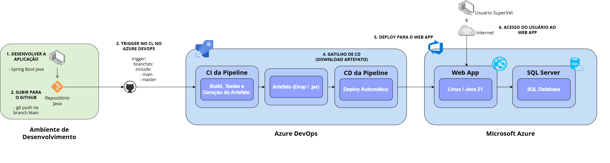

# SuperVet - Sprint 4: DevOps Tools & Cloud Computing

Este repositório contém a entrega final (Sprint 4) do projeto SuperVet, focado na implementação da disciplina de **Java Advanced** aliada a práticas modernas de DevOps e Cloud Computing.

## 1. Descrição da Solução

O **SuperVet** é um sistema de gerenciamento de clínicas veterinárias. A aplicação web permite que tutores gerenciem seus pets e agendem consultas, enquanto médicos veterinários podem visualizar suas agendas, gerenciar prontuários e interagir com as solicitações de atendimento. 

**Stack de Tecnologias:**
* **Back-end & Web:** Java 21, Spring Boot (Web, MVC, Data JPA, Security, OAuth2), Thymeleaf.
* **Build & Dependências:** Gradle.
* **Banco de Dados (Testes):** H2 Database (em memória).
* **Banco de Dados (Produção - Nuvem):** Azure SQL Database (PaaS).
* **Migração de Dados:** Flyway (Versionamento de banco de dados).
* **Hospedagem (Cloud):** Azure Web App (Linux).
* **CI/CD:** Azure DevOps.

---

## 2. Configuração do Projeto no Azure DevOps

A esteira de integração e entrega contínuas foi inteiramente configurada no ambiente do Azure DevOps, seguindo os requisitos estabelecidos:

* **Project Name:** Sprint 4 – Azure DevOps
* **Description:** Projeto para entrega da Sprint 4 do professor Antonio Sergio Rodrigues Figueiredo
* **Visibility:** Private
* **Version control:** Git
* **Work item process:** Scrum (ou Agile)

### Integrantes

| Nome | RM |
|---|---|
| Maria Luiza Alves de Aquino | RM561802 |
| Natan Freitas De Moraes | RM564992 |
| João Victor Gomes de Souza | RM560907 |
| Lucas Barranha Giannini | RM564508 |

*(Nota: O professor foi convidado para a organização no Azure DevOps com nível de acesso "Basic").*

---

## 3. Diagrama da Arquitetura e Fluxo CI/CD

A arquitetura engloba desde a máquina do desenvolvedor até o acesso do usuário final ao ambiente provisionado no Microsoft Azure. O fluxo ocorre na seguinte ordem:

1. **Desenvolvedor** realiza o push do código-fonte para o repositório **GitHub** (branch `main`/`master`).
2. O **Azure DevOps (Pipeline CI)** detecta a alteração automaticamente através de um trigger configurado.
3. O **Azure Pipelines** aloca um agente (Ubuntu) e executa o **Gradle** para realizar o Build da aplicação e executar os testes unitários/integrados (usando o banco H2 em memória).
4. Sendo o build e os testes bem-sucedidos, o artefato final (arquivo `.jar` executável) é gerado e **publicado (Drop)** no próprio ambiente do Azure DevOps.
5. A etapa de **CD (Continuous Delivery)** é acionada automaticamente, baixando o artefato seguro recém-publicado.
6. A pipeline realiza o deploy contínuo do artefato para o **Azure Web App (PaaS - Linux/Java 21)**.
7. A aplicação web inicia, conecta-se com segurança ao **Azure SQL Database (PaaS)**, e o Flyway executa as migrações (criação de tabelas e inserção de dados iniciais).
8. O **Usuário Final** acessa a aplicação através do navegador pela URL pública do Azure Web App.

---

## 4. Banco de Dados em Nuvem (PaaS)

O projeto utiliza um Banco de Dados em Nuvem na modalidade **PaaS (Platform as a Service)**.
A tecnologia escolhida foi o **Azure SQL Database**.
As credenciais e a URL de acesso são injetadas em tempo de execução pela pipeline (variáveis de ambiente), mantendo o código seguro e o banco protegido na nuvem. Toda a estrutura e tabelas (`usuarios`, `pets`, `consultas`, etc.) são criadas de forma automatizada pelo Flyway no momento em que a aplicação "sobe" no Azure.

---

## 5. Pipelines CI/CD e Segurança

A automação foi implementada utilizando YAML (`azure-pipelines.yml`), garantindo as melhores práticas:

### Integração Contínua (CI)
* **Gatilho (Trigger):** Configurado para disparar automaticamente em qualquer commit na branch `main` ou `master`.
* **Testes Automáticos:** A *task* do Gradle executa todos os testes da aplicação (`./gradlew test`) num ambiente isolado usando o banco de dados em memória H2, garantindo que o banco de produção não seja afetado.
* **Publicação de Artefato:** Após o build e a passagem dos testes, o arquivo `.jar` é extraído e publicado na pasta do Azure DevOps via task `PublishBuildArtifacts@1`.

### Entrega Contínua (CD)
* **Deploy Automático:** O Job de Deploy depende (`dependsOn`) do Job de CI. Ele só é executado se os testes passarem.
* **Azure Web App:** Utilizamos a *task* `AzureWebApp@1` para provisionar o artefato no serviço de hospedagem da Azure.
* **App Settings Dinâmicos:** Passamos a variável de inicialização `-SPRING_PROFILES_ACTIVE azure` durante o deploy para que o Spring utilize as propriedades corretas do ambiente remoto.

### Proteção de Dados Sensíveis
Todos os dados de conexão do banco de produção estão protegidos utilizando o recurso de **Library (Variable Groups)** do Azure DevOps. O grupo `SuperVet-Secrets-BD` contém:
* `DB_URL`
* `DB_USER`
* `DB_PASSWORD`
Essas variáveis estão marcadas como **Secrets (Cadeado fechado)**, garantindo que não sejam expostas nos logs da pipeline e sejam injetadas com segurança apenas na execução da aplicação.

---

## Links Importantes (Também presentes no PDF de entrega)

* **Repositório GitHub:** https://github.com/nfreitas2000/SuperVet_Sprint4_DevOps-Java-
* **Vídeo no YouTube (Demonstração):** A gravar
* **Projeto no Azure DevOps:** https://dev.azure.com/RM564992/Sprint%204%20–%20Azure%20DevOps